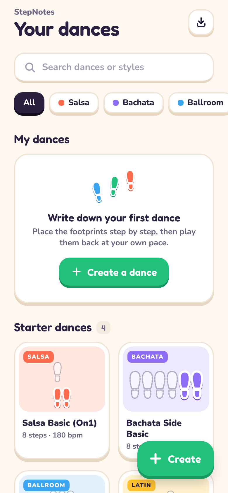
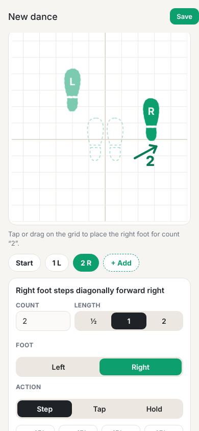
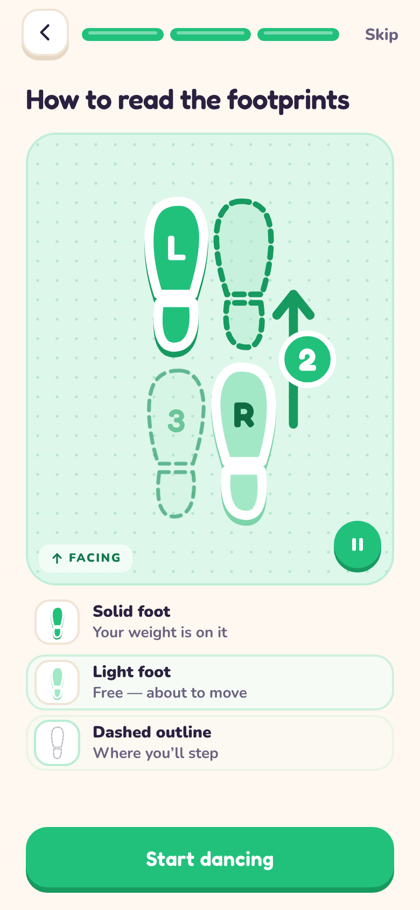

# StepNotes

A mobile app (iOS and Android, built with Expo / React Native) for **learning and writing down dance steps as footprint diagrams**: the numbered "feet and arrows" charts dance schools hand out, but animated, slowed down and editable.

<p>
  
  
  
  
  
</p>

## What it does

- **Intro** (first launch): three short steps. Welcome, which part you dance (leader, follower or both), and a one-minute interactive lesson on reading the footprints. The lesson can be opened again from the library.
- **Library**: four starter routines of beginner figures (Slow Waltz: box and left box turn; Cha-cha: basic and New Yorker; Salsa On1: basic, side basic and the follower's right turn; Bachata: side basic and the follower's inside turn) and your own dances, with search and style filters.
- **Player**
  - *Animate*: the feet glide on the beat. The foot carrying your weight is solid, the free foot is light, and the moving foot has a thick numbered arrow and a dashed outline where it will land. Taps, holds and turns each look different from a normal step.
  - Big count, a plain-language description ("Right foot steps back"), beat pills to jump to any step, and previous / next to walk through one step at a time.
  - *Chart*: the printed view with every position numbered, one chart per bar (short dances of up to three bars can also show all steps at once).
  - Leader, Follower or **Both** side by side, in sync.
  - Tempo 50–125 %, loop, spoken counts, mirror mode, L / R letters, and vibration on each step (phones only).
  - Duplicate, share as text, delete (with undo).
- **Editor**: drag the feet on a grid, press and hold a foot to turn it (the toes follow your finger, in 15° steps; the ±15° buttons do the same), drag the empty floor to move the view (the crosshair shows everything again), and set each step's count, length (½ / 1 / 2 beats), foot, action (step, tap, hold) and a note. Generate the follower part as a mirror of the leader, then adjust it. Undo for every change. "Make my own version" of a starter dance opens the editor on a copy that is only saved when you press Save.
- **Import**: paste a dance someone shared (extra chat text around it is fine).
- Everything is stored on the device. There are no accounts and no server.
- **Languages**: German (the default for now) and English. Switch with the globe button in the library header, or with DE | EN on the first intro screen. The choice is saved with the other settings.

## Run it

```bash
npm install
npx expo start
```

Press `w` to open it in a browser, or `i` / `a` for a simulator. The app uses only modules included in Expo Go, so you can also scan the QR code with Expo Go.

Before committing:

```bash
npm run lint && npm run typecheck
```

Builds for the stores use EAS (`npx eas-cli@latest build`). The `ios/` and `android/` folders are generated, so configure native settings in `app.json`.

## Project layout

```
src/
  app/                    screens (Expo Router)
    _layout.tsx           providers, fonts, splash screen, first-run redirect
    intro.tsx             intro; /intro?lesson=1 shows only the lesson
    index.tsx             library
    dance/[id].tsx        player
    edit/[id].tsx         editor ("new" creates a dance, ?from=<id> copies one)
    import.tsx            paste a shared dance
  components/
    ui/                   design system: Text, PressableLip, Button, Segmented, Sheet, Toast…
    StepDiagram.tsx       the SVG diagram: animation, chart and touch editing
    FootShape.tsx         shoe and heel footprints
    library/ player/ editor/ intro/   parts of each screen
  lib/
    types.ts              data model
    pattern.ts            step maths: weight, interpolation, mirror, partner, descriptions
    chartLayout.ts        arrow and label placement for the chart and the animation
    usePlayback.ts        beat clock (runs on the UI thread)
    useDanceDraft.ts      editor state with undo
    store.tsx, prefs.tsx  saved dances and settings (AsyncStorage)
    validate.ts           checks imported and stored dances
    i18n/                 German and English texts, useT(), plurals
    builtins.ts           starter dances
    theme.ts              colours, type, spacing
```

## Languages

All user-facing text lives in `src/lib/i18n/`: `en.ts` is the source and defines the `Strings` type, `de.ts` must match it exactly (a missing or extra key does not compile). Components call `useT()`; code outside React (step descriptions, validation errors) takes the dictionary as an argument. Sentences with values are functions (`t.count.stepOf(3, 8)`), plurals go through `plural.ts`, and step descriptions are written per language from the step's structure (`analyzeStep` in `pattern.ts`). The starter dances get their names, styles, descriptions and notes from the dictionaries too.

To add a language: add its code to `LANGUAGES` in `languages.ts`, write `xx.ts` typed as `Strings` (start from `en.ts`), add a plural rule in `plural.ts` and register the dictionary in `STRINGS` in `index.tsx`. If its style names differ (like "Latein"), add them to `STYLE_ALIASES` in `theme.ts` so they keep their colours.

## Data model

A `Dance` has a name, style, tempo (bpm), beats per bar, a `leader` pattern and an optional `follower` pattern. A pattern is a **start position** for both feet plus a list of **steps**. Each step has a count label (`"1"`, `"&"`, …), a length in beats, which foot moves, an action (`step` takes the weight, `tap` touches without weight, `hold` pauses), where the foot ends up (`x`, `y`, `rot`) and optionally a `pivot`: how far the weight-bearing foot swivels on the spot meanwhile (spins, turns). The dancer faces up the screen at the start (after a turn, "forward" in the descriptions and the facing arrow follow the dancer) and one unit is about one foot width. Weight, animation, charts and descriptions are all calculated from this.

Shared dances are this same structure as JSON text.

> The starter routines were researched figure by figure; the sources and the points a dance teacher should double-check are listed next to each dance in `src/lib/builtins.ts`.

See [`docs/PRODUCT_IDEAS.md`](docs/PRODUCT_IDEAS.md) for who the app is for, questions for a dancer, and the roadmap.
