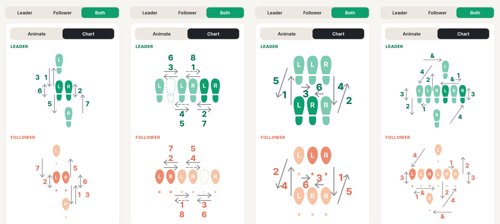

# StepNotes

A mobile app (iOS & Android, built with Expo / React Native) for **learning and writing down dance steps as footprint diagrams**: the kind of numbered "feet and arrows" charts dance schools print, but animated, slowed down and editable.

<p>
  
  
  
</p>



## What it does today (MVP)

- **Library** of starter dances (Salsa On1 basic, Bachata side basic, Waltz box, Cha-cha basic) plus your own dances.
- **Player**
  - *Animate*: the feet move step by step on the beat. The foot carrying the weight is dark and the free foot is light, and the current count is shown large.
  - *Chart*: the classic printed view, with every position and numbered arrows. Arrows and labels are laid out automatically so they don't cover the feet.
  - Leader / Follower / **Both** side by side, kept in sync on the beat.
  - Tempo 50–125 %, loop, step forward and back, **mirror mode** (for practising in front of a mirror or a teacher), spoken counts ("one, two, three, *and*…"), vibration on each step.
  - A plain-language description of each step ("Right foot steps diagonally forward right").
- **Editor**
  - Tap or drag on a grid to place each foot, rotate it for turns, and set the count, its length (½ / 1 / 2 beats), the action (step, tap or hold) and a note.
  - **Generate the follower part from the leader** (partners facing each other), then adjust it.
  - Footprint style per role (flat shoe / heel), plus BPM, description and a reference video link.
- **Share / import** a dance as text (JSON), so a teacher can send a pattern to students.
- Everything is stored on the device (AsyncStorage). There are no accounts and no backend yet.

## Run it

```bash
npm install
npx expo start
```

Scan the QR code with **Expo Go** on your phone (iOS or Android), or press `i` / `a` for a simulator. Press `w` to open it in a browser.

Before committing:

```bash
npm run lint && npm run typecheck
```

### Build for the stores

Use EAS:

```bash
npx eas-cli@latest build --platform all
```

You'll need an Apple Developer account and a Google Play account to publish.

## Project layout

```
src/
  app/                 # screens (Expo Router)
    index.tsx          # library
    dance/[id].tsx     # player
    edit/[id].tsx      # editor ("new" = create)
    import.tsx         # paste a shared dance
  components/
    StepDiagram.tsx    # the SVG diagram (chart + animation + touch editing)
    FootShape.tsx      # shoe / heel footprint shapes
    ui.tsx             # buttons, segmented controls…
  lib/
    types.ts           # data model (Dance → Pattern → Step)
    pattern.ts         # step maths: states, interpolation, mirror, partner, descriptions
    chartLayout.ts     # automatic arrow / label placement
    builtins.ts        # starter dances
    store.tsx          # persistence + import/export
    usePlayback.ts     # beat clock
```

### Data model in one paragraph

A `Dance` has a `leader` pattern and an optional `follower` pattern. A pattern is a **start position** for both feet plus a list of **steps**. Each step has a count label (`"1"`, `"&"`, …), a length in beats, which foot moves, the action (`step` takes the weight, `tap` touches without weight, `hold` pauses) and where the foot ends up (`x`, `y`, `rot`). The dancer faces up the screen, and one unit is about one foot width. Everything else (weight, animation, chart, descriptions) is calculated from that.

> ⚠️ The starter dances are simplified textbook basics written by a non-dancer. Ask your dancer to check them.

See [`docs/PRODUCT_IDEAS.md`](docs/PRODUCT_IDEAS.md) for who the app is for, questions to ask the dancer, and a roadmap.
